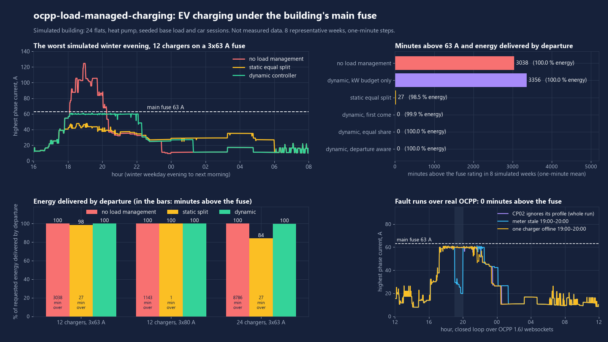
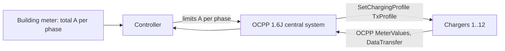

# ocpp-load-managed-charging

EV charging in an apartment building without upgrading the grid connection: an OCPP 1.6J central system that keeps the flats plus every charger under the main fuse, phase by phase, and shares the rest fairly. Real protocol, simulated building and cars.



## What it does

- **OCPP 1.6J central system** (Python, the MIT-licensed `ocpp` library, asyncio websockets, subprotocol `ocpp1.6`). It receives BootNotification, StatusNotification, StartTransaction/StopTransaction and MeterValues (`Current.Import` per phase L1-L3, energy register).
- **Every minute** it sends each active session a `SetChargingProfile` (TxProfile, absolute, limit in A per phase). After every boot it sends a TxDefaultProfile with a 6 A failsafe limit, so a new or offline session starts low.
- **Fuse rule:** building base load + all chargers <= main fuse (default 3x63 A, configurable, e.g. `--fuse 80`) minus a 3 A margin, on each phase separately. Base load = building meter minus the currents of the sessions under control.
- **Phase aware:** chargers are installed with rotated phases; a single-phase car is detected from its per-phase MeterValues and only counts on its phase. Until detected, a car counts on all three.
- **Minimum current:** a car gets 6 A or more, or it is paused (limit 0 A). Paused cars take over from running ones only every 15 minutes (no flapping).
- **Fair sharing**, three policies: equal share (max-min fair water filling), first come, departure aware (cars that must leave soon get the current they need first). Departure time and energy wish come from the resident over OCPP `DataTransfer` (stands in for an app).
- **Failure handling:** an offline charger keeps its last limit reserved; a stale meter switches to an assumed worst-case base load (55 A); a charger that draws more than its limit (+1.5 A) is flagged and its full rating is reserved.
- **Comparison on the same simulated weeks:** no load management, static equal split (fixed 45 A reserve for the flats, no meter), the dynamic controller, and an ablation that only checks the total kW budget (not phase aware).

## Results

Simulated building: 24 flats with a heat pump, 12 chargers (11 kW, a third of the cars charge on one phase), seeded base load and car sessions, 8 representative weeks (two each in January, April, July, October), one-minute steps. 316 sessions, 4.28 MWh requested. "Above the fuse" = one-minute mean current on any phase above the rating. All numbers come from `python -m olmc demo` (`results/summary.md`, `results/metrics.json`).

**12 chargers, 3x63 A (main case)**

| Strategy | Minutes above fuse | Max phase current | Peak building power | Energy delivered by departure | Worst session | Worst car | Jain index (sessions) | Pauses per session |
|---|---|---|---|---|---|---|---|---|
| No load management | 3038 | 124.5 A | 74.9 kW | 100 % | 100 % | 100 % | 1.000 | 0 |
| Static equal split | 27 | 69.1 A | 43.8 kW | 98.46 % | 60.3 % | 93.4 % | 0.998 | 2.3 |
| Dynamic, equal share | **0** | 61.8 A | 41.9 kW | 99.96 % | 96.5 % | 99.7 % | 1.000 | 0.21 |
| Dynamic, first come | **0** | 62.0 A | 41.9 kW | 99.93 % | 93.5 % | 99.4 % | 1.000 | 0.16 |
| Dynamic, departure aware | **0** | 61.8 A | 41.9 kW | **100 %** | **100 %** | 100 % | 1.000 | 0.20 |
| Dynamic, kW budget only (not phase aware) | 3356 | 86.1 A | 42.5 kW | 100 % | 100 % | 100 % | 1.000 | 0.04 |

- The kW-only controller keeps total power right but overloads single phases: more minutes above the fuse than no control at all. Phase awareness is not optional.
- The dynamic controller leaves a short overshoot after sudden base-load steps until the cars follow (10 s modelled): 3820 s in 8 weeks, never long enough to lift a one-minute mean above 63 A.
- Controller decision time (pure Python, 4-core laptop shared with other jobs): median 29 us, 99th percentile 300 us per cycle.

**Sensitivity**

| Case | Strategy | Minutes above fuse | Energy delivered | Worst session |
|---|---|---|---|---|
| 12 chargers, 3x80 A | no load management | 1143 | 100 % | 100 % |
| | static equal split | 1 | 99.94 % | 94.3 % |
| | dynamic, departure aware | **0** | 100 % | 100 % |
| 24 chargers (every flat), 3x63 A, 629 sessions | no load management | 8786 | 100 % | 100 % |
| | static equal split | 27 | 83.93 % | 21.7 % |
| | dynamic, equal share | **0** | 99.59 % | 66.4 % |
| | dynamic, departure aware | **0** | 99.84 % | 84.7 % |

**Closed loop over real OCPP websockets** (localhost, 12 simulated chargers, departure-aware policy, 24 virtual hours from 12:00 on a January weekday, 9 sessions):

| Run | Minutes above fuse | Max phase current | Energy delivered | Profiles sent / accepted | MeterValues | Cycle time p50 / p95 / max | What the controller logged |
|---|---|---|---|---|---|---|---|
| No fault | 0 | 60.9 A | 100.0 % | 2243 / 2243 | 7592 | 15.1 / 34.5 / 62.7 ms | - |
| CP01 websocket lost 19:00-20:00 | 0 | 60.9 A | 100.0 % | 2184 / 2184 | 7532 | 15.9 / 33.8 / 78.8 ms | t+420 min CP01: offline; t+480 min CP01: back online |
| Meter frozen 19:00-20:00 | 0 | 61.2 A | 100.0 % | 2636 / 2636 | 7592 | 17.2 / 34.8 / 92.1 ms | t+422 min meter: stale |
| CP02 accepts profiles but ignores them | 0 | 61.1 A | 100.0 % | 2074 / 2074 | 7592 | 21.9 / 33.6 / 62.2 ms | t+250 min CP02: ignores profile |

Cycle time = meter read, decision, SetChargingProfile to every active session (up to 9 at once) and all replies received, on localhost. The non-compliant charger was flagged in its first cycle (it drew 16 A against the 6 A default profile) and its full 16 A was reserved from then on.

## Quick start

```bash
uv venv .venv --python 3.12
uv pip install --python .venv/Scripts/python.exe -e ".[dev]"   # Linux/macOS: .venv/bin/python
.venv/Scripts/python.exe -m olmc demo          # ~6 min: 8 weeks x strategies + 4 OCPP runs; writes results/ and docs/
.venv/Scripts/python.exe -m olmc demo --quick  # one week + the OCPP runs (what CI runs)
.venv/Scripts/python.exe -m olmc live --fuse 80 --ignore CP05   # one closed-loop day, prints a JSON summary
.venv/Scripts/python.exe -m pytest -q -p no:asyncio && .venv/Scripts/ruff.exe check .
```

## How it works



- `olmc/allocate.py`: pure allocation. Admission in priority order at 6 A, then max-min fair water filling over coupled phases (or first come / departure need first). Limits are rounded down to 0.1 A, so the sum per phase never exceeds what is free.
- `olmc/controller.py`: one cycle, no I/O: headroom per phase from the meter, reserves for offline and non-compliant chargers, stale-meter fallback, phase detection, rotation.
- `olmc/csms.py`, `olmc/chargepoint.py`: OCPP 1.6J central system and simulated charger (obeys TxDefaultProfile and TxProfile; can be made to ignore them).
- `olmc/sim.py`: minute simulation. Inside each minute the base load steps, the cars keep their old limits for 10 s (control cycle + charger and car response, assumed), then follow the new ones.
- `olmc/live.py`: the same loop over websockets with fault injection. `olmc/data.py`: the simulated building.

## Data sources

All data is simulated and seeded (`seed=7`), no measured data:
- Base load: 24 flats (fridge and standby, lights, kettle, hob on two phases, oven, dishwasher), a shared laundry room, lift and ventilation, and a modulating heat pump driven by a simulated seasonal temperature. About 64 MWh per year, highest phase 61 A.
- Cars: one per charger, commuter / home-office / retired driving profiles, 0.19 kWh/km (+20 % in winter), plug-in most evenings. The request is capped at what the car could take at full power while plugged in, so 100 % is reachable without a fuse.

## What is not verified yet

- Never run against real chargers, real cars or a real building meter. Only the simulated chargers in this repo spoke OCPP to it; no third-party charger was tested.
- Car behaviour is modelled: constant current up to the limit, no taper near full, instant pause below 6 A, no car that refuses to resume after a pause.
- The 10 s reaction time is assumed, not measured. Real meters, chargers and cars add their own delays.
- The fuse check uses one-minute means; fuse trip curves and sub-minute load peaks are not modelled.
- Departure time and energy wish come over a DataTransfer message as a stand-in for a residents' app; no app exists.
- One simulated building, one seed, 8 weeks.

## Licence

MIT, Copyright (c) 2026 VB-Builds. Dependencies: ocpp (MIT), websockets (BSD-3-Clause), numpy (BSD), matplotlib (matplotlib licence, BSD-style).
